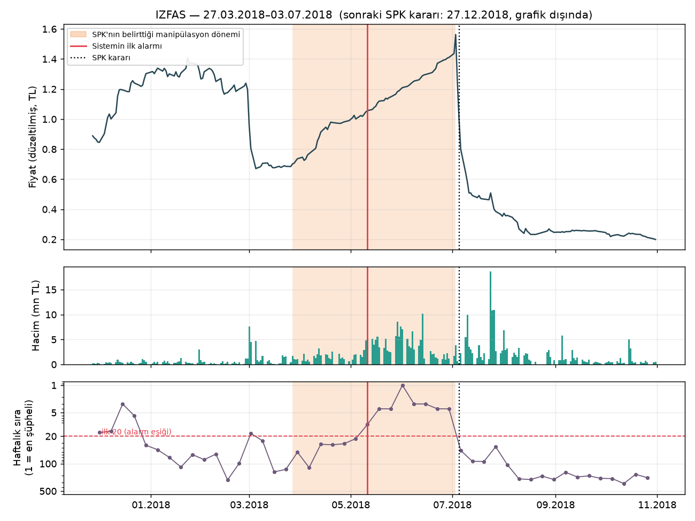
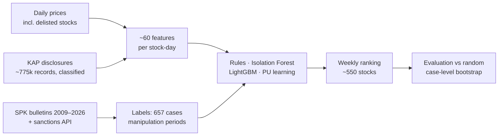

# Detecting Stock Manipulation on Borsa Istanbul

[](https://github.com/melihkoc1/bist-manipulation-detection/actions/workflows/tests.yml)
[](LICENSE)

**English** | [Türkçe](README.tr.md)

An early-warning system for **pump-and-dump manipulation** in Borsa Istanbul (BIST) stocks,
built from daily market data, company disclosures (KAP) and 17 years of regulator decisions
(SPK). Every week it ranks ~550 stocks by how suspicious their trading looks. It is evaluated
against real enforcement cases with a strict, look-ahead-free protocol.

*Undergraduate thesis project · Melih Erdem Koçoğlu · 2026–2027*

> Scores are **statistical anomaly signals, not accusations**. Companies named in this
> repository appear only because the Capital Markets Board of Turkey (SPK) published a
> decision about trading in their shares. Nothing here is investment advice.

## Key results

The evaluation covers 125 SPK cases from 2017–2026 with a known manipulation period. In the
"honest" setup, each year is scored by a model trained only on data and SPK decisions
available before that year:

| Model | AUC | Cases caught in weekly top 20 | Caught before price peak | Top-10 precision vs random |
|---|---|---|---|---|
| Random ranking | 0.50 | 22% (expected 23%) | 21% | 1.0× |
| Surveillance-style rules | 0.81 | 65% | 64% | 2.4× |
| PU learning (bagging) | 0.83 | 62% | 60% | 3.5× |
| **Rules + PU ensemble** | **0.85** | **67%** | **66%** | **3.4×** |

- **Detection is about 3× better than random.** The first alarm comes a median of 8 days after
  the manipulation starts.
- **Lead over the regulator.** For caught cases, the alarm precedes SPK's first action
  (often a trading ban) in 94% of cases, by a median of 28 days. It precedes the first fine or
  criminal complaint by a median of **13 months**.
- **PU learning helps.** It significantly beats ordinary supervised learning (AUC +0.03,
  paired case bootstrap). Combined with rules, it beats both rules and PU alone.
- **Extending the history helps.** Adding older regulator bulletins (2009–2015) grew the label
  set from 335 to 413 cases. This significantly improved the ML models (LightGBM AUC +0.05),
  which confirms they were limited by the number of labels, not by model capacity.
- **Older years.** Including 2012–2016 (184 cases in total), the ensemble catches 71% of cases,
  against 29% for random.
- **Robust.** The ensemble beats random at every list length (5.9× in the top 5, 2.9× in the top
  20), in 12 of 15 years, and equally for small, mid and large companies (2.5–2.7×). Its weak
  spots are clear: strong market-wide rallies (2022) and long, slow manipulations, which even a
  random list catches by luck. Details: [docs/saglamlik.md](docs/saglamlik.md).
- **What the learned model looks at.** SHAP explanations show the PU model relies most on
  free-float turnover (21%) and the rise from the 3-month low (13%), i.e. "shares changing hands
  very fast after a sharp rebound". It uses different information than the rules, which is why
  the two combine well. Details: [docs/aciklamalar.md](docs/aciklamalar.md).
- **Alarms without an SPK decision are mostly unusual too.** Among top-10 alarms that never got an
  SPK decision, 32% later received an exchange request to explain unusual price moves (random
  stocks: 5%) and 33% show a later pump-and-dump shape (random: 5%); none were data errors. The
  10% top-10 precision is therefore a lower bound. Details: [docs/bos_alarmlar.md](docs/bos_alarmlar.md).
- **Live test running.** The model was frozen on 2026-11-17 and every week's list is now recorded
  before anyone knows the outcome; it will be checked against new SPK decisions in June 2027
  (see [Live test](#live-test-prospective)).

Full tables: [docs/sonuclar_v2.md](docs/sonuclar_v2.md) · interpretation: [docs/yorum_v2.md](docs/yorum_v2.md)
(both in Turkish).

### What did not help

Every idea was tested with the same honest protocol, with settings fixed before looking at the
results. Code for failed ideas was not kept; all numbers are in the
[experiment log](docs/deneme_gunlugu.md) (Turkish). Effects are on the Rules + PU ensemble, 2017–2026.

| Idea | Result |
|---|---|
| "Price moves without news" features from company disclosures | No significant gain (thesis question 3) |
| Closing-price manipulation (close vs VWAP) features | No significant gain |
| The stock's own SPK history | Harmful (PU recall −11 points): the model memorizes stocks |
| Learning ensemble weights from past years | No gain (AUC +0.000) |
| More weight on recent years; ranking objective (lambdarank); tuning on past years | No gain; lambdarank significantly worse (recall −5.7 points) |
| Indicators tracking the whole run-up (days since low, cumulative turnover, …) | No gain: same information as existing features |
| Insider selling during the run-up (KAP filings) | No gain: SPK cases have *fewer* sell filings than random days (1.1% vs 1.7%) |
| Non-core cases (multi-stock, market measures) as weak labels | Tiny AUC gain (+0.003, borderline) but no better top of the list; main model unchanged |
| Borsa Istanbul volatility measures (VBTS: short-sale ban, gross settlement, single price) | No gain (AUC −0.001): the measures follow price volatility the model already sees |
| Price vs fundamentals (price-to-book, its deviation from the past year, earnings yield) | Harmful (recall −5.7 points): like company profile, the model memorises company types |
| Logistic regression instead of gradient-boosted trees (baseline) | AUC nearly the same; 3–7 points lower recall in the top 20 (not significant): most of the signal is linear |
| Other PU methods (Elkan–Noto reweighting, nnPU) | Elkan–Noto equals PU bagging; nnPU is worse (AUC −0.015, significant): the PU variant matters little |
| Random Forest / Extra Trees instead of LightGBM inside PU | PU alone AUC +0.02 (significant), but no change at the top of the list or in the ensemble with rules |
| Three-way ensemble (rules + PU-LightGBM + PU-Random Forest) | AUC 0.849 → 0.856 (significant, small) but top-20 recall did not improve; main model unchanged |

**Takeaway:** with daily price and volume data the model is near its limit. Further gains most
likely need new information (broker-level "AKD" data) or more pump-and-dump labels.

### Example: a textbook pump-and-dump (IZFAS, 2018)



**Price.** The price more than doubled in three months. After SPK imposed a trading ban, the
stock lost 87% of its value.

**What the system saw.** The ensemble flagged the stock on day 45 of the manipulation, before
59% of the rise, and ranked it #1 of ~550 stocks in June. The rules that fired that week:
- 34% return above the index over 20 days
- free-float turnover 3.3× its normal level
- 8 up days out of 10

More cases are covered in [docs/vaka_calismalari.md](docs/vaka_calismalari.md), including two
the system missed and why.

## How it works



### Labels: regulator decisions turned into cases

- **Parsing.** The parser reads ~1,000 weekly SPK bulletins in two formats:
  - pre-2012 bulletins name companies by legal title, not ticker, under the old law (art. 47/I-A-2);
  - newer bulletins have a structured sanctions section.
- **Case extraction.** It pulls out tickers, decision types and the manipulation period stated
  in the decision. Decisions about the same episode are merged into one case.
- **Scope.** Insider-trading, disclosure-only and warrant cases are excluded.
- **Accuracy.** A manual check of a sample found 94% label precision.

### Features (no look-ahead; every feature uses data up to day t only, unit-tested)

- **Returns:** return z-scores and excess return over the index.
- **Volume and turnover:** volume and free-float turnover relative to the stock's own history.
- **Price action:** limit-up streaks, up-day counts, close location, closing price vs VWAP.
- **Disclosures:** company disclosures classified by content into real news, price-reaction
  statements, rumors, etc. (93% accuracy on a held-out sample). This is used to test
  "price moves without news".

### Models

| Model | Type |
|---|---|
| Rule score | Count of surveillance-style thresholds |
| Isolation Forest | Unsupervised |
| LightGBM | Supervised; unlabeled days treated as negatives |
| PU learning | Positive-unlabeled; Elkan–Noto reweighting and Mordelet–Vert bagging |
| Rules + PU ensemble | Equal-weight average of weekly ranks, fixed before looking at results |

## Evaluation design and a note on rigor

**Protocol.** Models are retrained every year. Each year uses only data and SPK decisions
published before it, because SPK often announces cases years later. A walk-forward split that
ignored this would leak future labels into training.

**Metrics.** The question is practical: *if an analyst checked the top-k stocks every week,
which cases would they catch?* Results are reported with:
- **Random baseline:** an analytic one per case, P(caught at random) = 1 − Π(1 − k/Nₜ).
- **Confidence intervals:** case-cluster bootstrap.
- **Model comparisons:** paired bootstrap tests on the same cases.

**What we got wrong first.** A first version reported "40–47% of cases detected" without
comparing against chance. Once the random baseline was computed, that figure turned out to be
**no better than random**, because long label windows are easy to hit by luck. The result was
retracted and the whole evaluation was rebuilt. The retracted analysis is kept in
[docs/arsiv_v1/](docs/arsiv_v1/) for transparency.

**Other pitfalls found and fixed:**
- **Profile features let the model memorize which stocks had been manipulated before.** These
  were company size and free-float level. They were removed.
- **"Price moves without news" was distorted.** It counted the companies' own statements
  about unusual price moves as news. Fixed with content classification of disclosures.

## Thesis questions

| Question | Answer |
|---|---|
| 1. Can manipulation be detected early from daily data? | **Yes.** About 3× random, mostly before the price peak, over 15 years. |
| 2. Is PU learning better than supervised / unsupervised methods? | **Yes, partly.** Significantly better than supervised; tied with rules alone, better when combined. |
| 3. Do "moves without news" features help? | **No.** No significant gain. Adding all disclosure features even slightly hurts. |

## Limitations

- **Evaluable cases.** Only cases whose decision states the manipulation period can be
  evaluated: 184 of 413 core cases.
- **Slow manipulations are missed.** Slow, quiet manipulations, or ones riding a market-wide
  rally, look normal in daily data. Catching them likely needs broker-level data
  ("AKD", the next planned step).
- **False alarms.** About 90% of top-10 alarms are not SPK cases. Most of them still show unusual
  behaviour (see above), but without a regulator decision they cannot be called manipulation.
  The system is a triage tool, not a verdict.
- **Delisted companies.** Some delisted companies from early bulletins could not be matched
  to price data.

## Reproducing

The repository contains no data. Everything is downloaded from public sources, which takes
several hours in total.

```bash
python -m venv .venv && .venv/Scripts/python -m pip install -e ".[dev]"   # Windows paths

# 1. Labels
python -m bistmd.ingest.spk_api --start 2016 --end 2026
python -m bistmd.ingest.spk_bulletins --start 2009 --end 2026
python -m bistmd.ingest.universe
python scripts/inventory.py                          # merge decisions → cases, fetch prices for case stocks

# 2. Market data
python -c "from bistmd.ingest import universe, prices_isyatirim as p; p.download(sorted(universe.load().ticker))"
python -m bistmd.ingest.kap_disclosures --start 2010-01-01
python -m bistmd.db                                  # → data/db/bist.duckdb
python scripts/build_features.py --start 2010-04-01

# 3. Models and evaluation
python scripts/score_v2.py --mode honest             # all models, yearly honest retraining
python scripts/score_v2.py --mode loyo --models 2_lightgbm,3b_pu_bagging
python scripts/ensemble_v2.py
python scripts/evaluate_v2.py                        # → docs/sonuclar_v2.md
python scripts/compare_v2.py                         # paired tests
python scripts/case_studies.py IZFAS-0 SANEL-0 KGYO-0 KONYA-0 KUYAS-0
python scripts/robustness.py                         # → docs/saglamlik.md
python scripts/false_alarms.py                       # → docs/bos_alarmlar.md
python scripts/explain_v2.py                         # SHAP, ~40 min → docs/aciklamalar.md

python -m pytest
```

Some paired comparisons in `compare_v2.py` reference earlier score snapshots
(`scores_v2_before`, `scores_v2_novwap`). They are skipped when those folders are missing.

## Live test (prospective)

The model was frozen on 2026-11-17 and every week's top-20 list is recorded before any outcome is
known; in June 2027 the lists will be compared with the new SPK decisions. The evaluation plan was
written before the first list: [docs/canli_test/protokol.md](docs/canli_test/protokol.md). Only the
fingerprints (sha256) of the lists enter the repository ([kayit.csv](docs/canli_test/kayit.csv));
the lists themselves stay local (`data/live/`).

```bash
python scripts/live_freeze.py          # once (already done): trains and freezes the PU model
python scripts/live_week.py            # every weekend: records last week's list (~25 min)
python scripts/live_week.py --verify   # checks all fingerprints
python scripts/export_web.py --live    # refreshes only the site's "Live test" page
```

On the local site, clicking a week in the "Live test" log opens that week's recorded top-20 CSV in a
new tab. For any public copy of the site use `--live --no-lists` (fingerprints only).

## Demo site

A local website for presenting the project (React + TypeScript + Vite; English / Turkish, light /
dark theme, mobile-friendly). It needs the data pipeline above to have been run; its data is
produced by `scripts/export_web.py` (`web/public/data/`, not in the repository). If `explain_v2.py` has been run, the "Why suspicious?" panel also shows the PU model's SHAP contributions.

```bash
.venv/Scripts/python scripts/export_web.py      # ~2 min, ~115 MB of JSON
cd web && npm install && npm run dev            # opens http://localhost:5173
```

| Page | What it shows |
|---|---|
| **Overview** | Key results (each next to its random baseline), a "3× better than random" visual, a featured case. |
| **Time machine** | Pick any week from 2012–2026 and a model. See the top 10/20/50 list the system produced that week without any later information, the rules that fired for each stock, and which ones later got an SPK decision. |
| **Stock detail** | Price, volume and weekly rank (3 panels) with SPK periods, SPK decisions and the first alarm marked; "why suspicious?" for a chosen week; SPK decision timeline; KAP disclosures. |
| **Case studies** | 3 caught and 2 missed cases, with the sequence of events and lessons. |
| **Results** | Period selector, model comparison, timing vs the regulator, thesis answers, experiment log. |
| **Live test · Method · About** | Running prospective test (record times and fingerprints; locally, each week's list), method and ethics, project info. |

The site listens on `localhost` only; real weekly lists are never published online. Design files
are in `design/`. The earlier Streamlit app (`app/`) still works:
`.venv/Scripts/python -m streamlit run app/streamlit_app.py`.

## Repository layout

```
src/bistmd/
  ingest/     SPK API & bulletins, İş Yatırım prices, KAP disclosures, company list
  labels/     bulletin parsing (old and new formats), ticker resolution, cases, label windows
  features/   price/volume features, KAP content classification and features
  models/     rules, Isolation Forest, LightGBM, PU learning
  eval/       weekly ranking metrics, random baseline, bootstrap
scripts/      pipeline entry points (scoring, ensemble, evaluation, case studies)
web/          demo site (React + TypeScript), data from scripts/export_web.py
app/          earlier Streamlit demo app
design/       approved design files for the demo site
tests/        68 unit tests (no data needed), incl. look-ahead tests for features
docs/         results, interpretation, validation, case studies, experiment log (Turkish)
  canli_test/ live test: frozen-model manifest, pre-registered protocol, weekly fingerprints
```

## Data sources

| Data | Source |
|---|---|
| Enforcement decisions | SPK weekly bulletins (2009–2026) and SPK sanctions API |
| Daily prices, market cap, free float | İş Yatırım (includes delisted stocks, avoiding survivorship bias) |
| Company disclosures | KAP (Public Disclosure Platform) |

**Data handling.**
- Raw data is not redistributed.
- Personal data in SPK decisions (names, ID numbers) is never stored in processed tables.

## Türkçe

Bu belgenin tam Türkçe sürümü: [README.tr.md](README.tr.md). Ayrıntılı sonuç ve yorum belgeleri
(`docs/`) Türkçedir.

## License

[MIT](LICENSE) © 2026 Melih Erdem Koçoğlu
