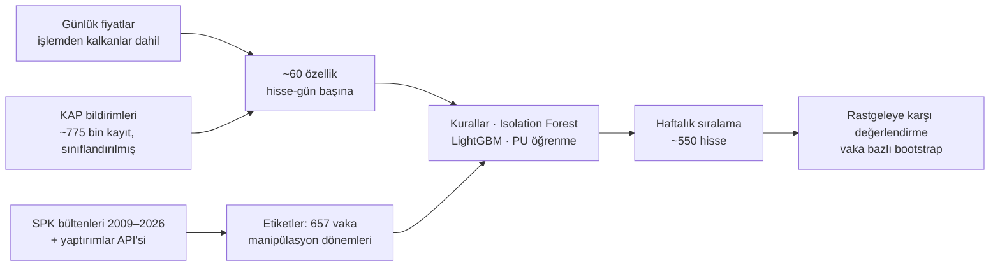

# Borsa İstanbul'da Manipülasyon Tespiti

[](https://github.com/melihkoc1/bist-manipulation-detection/actions/workflows/tests.yml)
[](LICENSE)

[English](README.md) | **Türkçe**

Borsa İstanbul hisselerinde **pompala-boşalt** türü manipülasyon için bir erken uyarı sistemi.

- **Veri:** günlük piyasa verisi, şirket bildirimleri (KAP) ve 17 yıllık SPK kararları.
- **Çıktı:** sistem her hafta ~550 hisseyi işlemlerinin ne kadar şüpheli göründüğüne göre sıralar.
- **Test:** gerçek SPK vakalarıyla, geleceği görmeyen ("dürüst") bir protokolle ölçüldü.

*Lisans bitirme projesi · Melih Erdem Koçoğlu · 2026–2027*

> Skorlar **istatistiksel anomali sinyalleridir, suçlama değildir.** Bu depoda adı geçen
> şirketler, yalnızca SPK'nın paylarındaki işlemlerle ilgili kamuya açık bir karar yayımlamış
> olması nedeniyle yer alır. Buradaki hiçbir şey yatırım tavsiyesi değildir.

## Temel sonuçlar

**Değerlendirme kümesi:** dönemi bilinen 125 SPK vakası (2017–2026).

**Dürüst kurulum:** her yıl, yalnızca o yıldan önce mevcut olan veri ve SPK kararlarıyla eğitilmiş bir modelle puanlandı.

| Model | AUC | Haftalık ilk 20'de yakalanan vaka | Fiyat zirvesinden önce yakalanan | İlk 10 isabeti (rastgeleye göre) |
|---|---|---|---|---|
| Rastgele sıralama | 0,50 | %22 (beklenen %23) | %21 | 1,0× |
| Gözetim tarzı kurallar | 0,81 | %65 | %64 | 2,4× |
| PU öğrenme (bagging) | 0,83 | %62 | %60 | 3,5× |
| **Kural + PU birleşimi** | **0,85** | **%67** | **%66** | **3,4×** |

- **Rastgeleden yaklaşık 3 kat iyi.** İlk alarm, manipülasyon başladıktan medyan 8 gün sonra geliyor.
- **SPK'ya göre zaman kazancı.** Yakalanan vakalarda alarm:
  - SPK'nın ilk işleminden (genelde işlem yasağı) **%94 oranında önce** geliyor, medyan 28 gün önce.
  - İlk para cezası veya suç duyurusundan medyan **13 ay** önce geliyor.
- **PU öğrenme işe yarıyor.** Klasik gözetimli öğrenmeyi anlamlı biçimde geçiyor (AUC +0,03, eşleştirilmiş vaka bootstrap'i).
  - Kurallarla birleştirildiğinde hem kuralları hem tek başına PU'yu geçiyor.
- **Geçmişi uzatmak işe yarıyor.** Eski SPK bültenleri (2009–2015) eklenince vaka sayısı 335'ten 413'e çıktı.
  - ML modelleri anlamlı biçimde iyileşti (LightGBM AUC +0,05).
  - Bu, modellerin model kapasitesiyle değil, etiket sayısıyla sınırlı olduğunu doğruluyor.
- **Daha eski yıllar.** 2012–2016 dahil (toplam 184 vaka), birleşik model vakaların %71'ini yakalıyor; rastgele seçimde bu oran %29.

**Belgeler:**
- Tüm tablolar: [docs/sonuclar_v2.md](docs/sonuclar_v2.md)
- Yorum: [docs/yorum_v2.md](docs/yorum_v2.md)

### Örnek: klasik bir pompala-boşalt (IZFAS, 2018)


**Fiyat hareketi.** Fiyat üç ayda iki katından fazla arttı. SPK işlem yasağı getirdikten sonra hisse değerinin %87'sini kaybetti.

**Sistem ne gördü?**
- Birleşik model hisseyi manipülasyonun 45. gününde işaretledi. Yükselişin %59'u henüz gerçekleşmemişti.
- Haziran'da hisseyi ~550 hisse arasında 1. sıraya koydu.
- O hafta tetiklenen kurallar:
  - 20 günde endeksin %34 üstünde getiri
  - halka açık kısma göre işlem hacminin normalin 3,3 katı olması
  - son 10 günün 8'inde yükseliş

Diğer vakalar, sistemin kaçırdığı iki vaka ve nedenleriyle birlikte, [docs/vaka_calismalari.md](docs/vaka_calismalari.md) içinde.

## Nasıl çalışıyor?



### Etiketler: SPK kararlarından vakalara

- **Bülten okuma.** Ayrıştırıcı ~1.000 haftalık SPK bültenini iki farklı biçimde okur:
  - 2012 öncesi bültenler hisse kodu yerine şirket unvanı kullanır ve eski kanunun 47/I-A-2 maddesine atıf yapar.
  - Yeni bültenlerde yapılandırılmış bir yaptırımlar bölümü vardır.
- **Vaka çıkarma.** Hisse kodlarını, karar türlerini ve kararda yazan manipülasyon dönemini çıkarır. Aynı olaya ait kararlar tek vakada birleştirilir.
- **Kapsam dışı.** İçerden öğrenenlerin ticareti, yalnızca bildirim ihlali ve varant vakaları dışarıda tutulur.
- **Doğruluk.** Elle kontrol edilen bir örneklemde etiket isabeti %94.

### Özellikler

Geleceği görme yok: her özellik yalnızca t gününe kadarki veriyi kullanır, bu birim testlerle kontrol edilir.

- **Getiri:** getiri z-skorları ve endeks üstü getiri.
- **Hacim ve devir:** hissenin kendi geçmişine göre hacim ve halka açık kısma göre devir hızı.
- **Fiyat davranışı:** tavan serileri, yükselen gün sayısı, kapanışın gün içi konumu, kapanış ile VWAP karşılaştırması.
- **KAP bildirimleri:** içeriğe göre sınıflandırılır: gerçek haber, olağandışı fiyat hareketi açıklaması, söylenti vb.
  - Sınıflandırma, ayrı tutulan bir örneklemde %93 doğru.
  - "Habersiz fiyat hareketi" hipotezini test etmek için kullanılır.

### Modeller

| Model | Tür |
|---|---|
| Kural skoru | Borsa gözetimi tarzı eşiklerin sayımı |
| Isolation Forest | Gözetimsiz |
| LightGBM | Gözetimli; etiketsiz günler negatif sayılır |
| PU öğrenme | Pozitif-etiketsiz; Elkan–Noto ağırlıklandırma ve Mordelet–Vert bagging |
| Kural + PU birleşimi | Haftalık sıraların eşit ağırlıklı ortalaması; ağırlıklar sonuçlara bakılmadan sabitlendi |

## Değerlendirme tasarımı ve titizlik üzerine

**Protokol.** Modeller her yıl yeniden eğitilir. Her yıl, yalnızca o yıldan önce yayımlanmış veri ve SPK kararlarını kullanır.
SPK vakaları çoğu zaman yıllar sonra açıklar. Bunu dikkate almayan bir zaman bölmesi, gelecekteki etiketleri eğitime sızdırırdı.

**Ölçütler.** Soru pratik: *bir analist her hafta en şüpheli k hisseye baksaydı, hangi vakaları yakalardı?* Sonuçlar şunlarla raporlanır:
- **Rastgele taban:** her vaka için analitik olarak hesaplanır. Rastgele yakalanma olasılığı = 1 − Π(1 − k/Nₜ).
- **Güven aralıkları:** vaka kümesi bootstrap'i.
- **Model karşılaştırmaları:** aynı vakalar üzerinde eşleştirilmiş bootstrap testleri.

**Önce neyi yanlış yaptık?**
- İlk sürüm, şansla karşılaştırmadan "vakaların %40–47'si tespit edildi" diye raporlamıştı.
- Rastgele taban hesaplanınca bu rakamın **rastgeleden iyi olmadığı** görüldü. Uzun etiket pencerelerine şans eseri isabet etmek kolay.
- Sonuç geri çekildi ve değerlendirme baştan kuruldu.
- Geri çekilen analiz şeffaflık için [docs/arsiv_v1/](docs/arsiv_v1/) içinde duruyor.

**Bulunup düzeltilen diğer tuzaklar:**
- **Profil özellikleri ezbere yol açıyordu.** Şirket büyüklüğü ve halka açıklık oranı, modelin hangi hisselerin geçmişte manipüle edildiğini ezberlemesine yol açtı. Çıkarıldı.
- **"Habersiz hareket" ölçütü çarpıktı.** Şirketlerin olağandışı fiyat hareketiyle ilgili kendi açıklamalarını da haber sayıyordu. Bildirimlerin içeriğe göre sınıflandırılmasıyla düzeltildi.

## Tez soruları

| Soru | Cevap |
|---|---|
| 1. Manipülasyon günlük veriyle erken tespit edilebilir mi? | **Evet.** 15 yıl boyunca rastgelenin yaklaşık 3 katı; çoğunlukla fiyat zirvesinden önce. |
| 2. PU öğrenme gözetimli / gözetimsiz yöntemlerden iyi mi? | **Kısmen evet.** Gözetimliden anlamlı biçimde iyi; tek başına kurallarla başa baş, birleştirilince daha iyi. |
| 3. "Habersiz hareket" özellikleri işe yarıyor mu? | **Hayır.** Anlamlı kazanç yok; tüm bildirim özelliklerini eklemek sonucu biraz kötüleştiriyor. |

## Sınırlılıklar

- **Değerlendirilebilen vakalar.** Yalnızca kararında manipülasyon dönemi yazan vakalar değerlendirilebiliyor: 413 ana vakanın 184'ü.
- **Yavaş manipülasyonlar.** Yavaş ve sessiz manipülasyonlar ya da piyasa genelindeki bir yükselişe eşlik edenler günlük veride normal görünüyor.
  Bunları yakalamak için muhtemelen aracı kurum düzeyinde veri gerekiyor. Planlanan sonraki adım "AKD".
- **Yanlış alarmlar.** İşaretlenen hisselerin çoğu SPK vakası değil.
  - Bazıları SPK'nın hiç incelemediği manipülasyonlar olabilir, ama çoğu muhtemelen gerçek oynaklık.
  - Sistem bir hüküm aracı değil, önceliklendirme aracıdır.
- **Eşleşmeyen eski şirketler.** İlk bültenlerdeki, borsadan çıkmış bazı şirketler fiyat verisiyle eşlenemedi.

## Projeyi baştan çalıştırma

Depoda veri yok. Her şey kamuya açık kaynaklardan indirilir; toplam birkaç saat sürer.

```bash
python -m venv .venv && .venv/Scripts/python -m pip install -e ".[dev]"   # Windows yolları

# 1. Etiketler
python -m bistmd.ingest.spk_api --start 2016 --end 2026
python -m bistmd.ingest.spk_bulletins --start 2009 --end 2026
python -m bistmd.ingest.universe
python scripts/inventory.py                          # kararları vakalara birleştir, vaka hisselerinin fiyatlarını indir

# 2. Piyasa verisi
python -c "from bistmd.ingest import universe, prices_isyatirim as p; p.download(sorted(universe.load().ticker))"
python -m bistmd.ingest.kap_disclosures --start 2010-01-01
python -m bistmd.db                                  # → data/db/bist.duckdb
python scripts/build_features.py --start 2010-04-01

# 3. Modeller ve değerlendirme
python scripts/score_v2.py --mode honest             # tüm modeller, yıllık dürüst yeniden eğitim
python scripts/score_v2.py --mode loyo --models 2_lightgbm,3b_pu_bagging
python scripts/ensemble_v2.py
python scripts/evaluate_v2.py                        # → docs/sonuclar_v2.md
python scripts/compare_v2.py                         # eşleştirilmiş testler
python scripts/case_studies.py IZFAS-0 SANEL-0 KGYO-0 KONYA-0 KUYAS-0

python -m pytest
```

`compare_v2.py` içindeki bazı eşleştirilmiş karşılaştırmalar daha önceki skor anlık görüntülerini kullanır (`scores_v2_before`, `scores_v2_novwap`). Bu klasörler yoksa o karşılaştırmalar atlanır.

## Depo yapısı

```
src/bistmd/
  ingest/     SPK API ve bültenleri, İş Yatırım fiyatları, KAP bildirimleri, şirket listesi
  labels/     bülten ayrıştırma (eski ve yeni biçim), hisse kodu eşleme, vakalar, etiket pencereleri
  features/   fiyat/hacim özellikleri, KAP içerik sınıflandırması ve özellikleri
  models/     kurallar, Isolation Forest, LightGBM, PU öğrenme
  eval/       haftalık sıralama ölçütleri, rastgele taban, bootstrap
scripts/      çalıştırma betikleri (puanlama, birleşim, değerlendirme, vaka çalışmaları)
tests/        68 birim testi (veri gerektirmez), özellikler için geleceği görme testleri dahil
docs/         sonuçlar, yorum, doğrulama, vaka çalışmaları
```

## Veri kaynakları

| Veri | Kaynak |
|---|---|
| Yaptırım kararları | SPK haftalık bültenleri (2009–2026) ve SPK idari yaptırımlar API'si |
| Günlük fiyat, piyasa değeri, halka açıklık | İş Yatırım (işlemden kalkan hisseler dahil; hayatta kalanlar yanlılığı önlenir) |
| Şirket bildirimleri | KAP (Kamuyu Aydınlatma Platformu) |

**Veri kullanımı.**
- Ham veri yeniden dağıtılmaz.
- SPK kararlarındaki kişisel veriler (ad, kimlik numarası) işlenmiş tablolarda hiç saklanmaz.

## Lisans

[MIT](LICENSE) © 2026 Melih Erdem Koçoğlu
