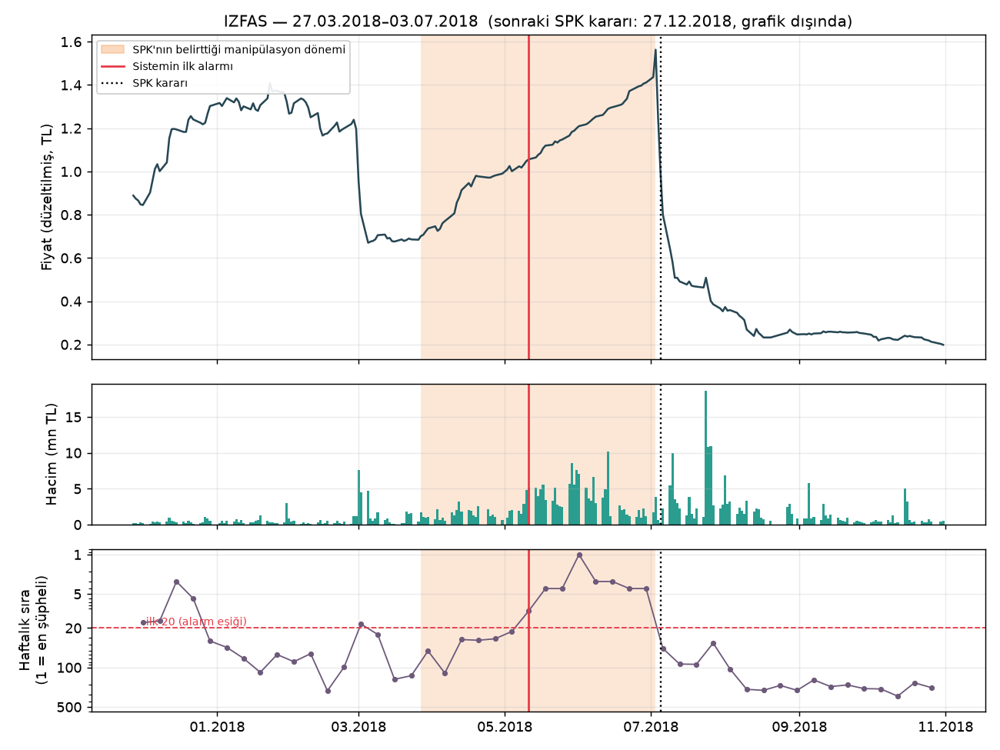
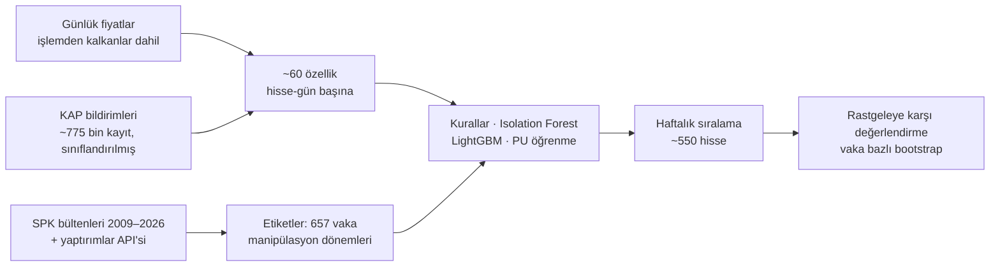

# Borsa İstanbul'da Manipülasyon Tespiti

[](https://github.com/melihkoc1/bist-manipulation-detection/actions/workflows/tests.yml)
[](LICENSE)

[English](README.md) | **Türkçe**

Borsa İstanbul hisselerinde **pompala-boşalt** türü manipülasyon için bir erken uyarı sistemi.

- **Veri:** günlük piyasa verisi, şirket bildirimleri (KAP) ve 17 yıllık SPK kararları.
- **Çıktı:** sistem her hafta ~550 hisseyi işlemlerinin ne kadar şüpheli göründüğüne göre sıralar.
- **Test:** gerçek SPK vakalarıyla, geleceği görmeyen ("dürüst") bir protokolle ölçüldü.

*Lisans bitirme projesi · Melih Erdem Koçoğlu · 2026–2027*

> Skorlar **istatistiksel anomali sinyalleridir, suçlama değildir.** Bu depoda adı geçen
> şirketler, yalnızca SPK'nın paylarındaki işlemlerle ilgili kamuya açık bir karar yayımlamış
> olması nedeniyle yer alır. Buradaki hiçbir şey yatırım tavsiyesi değildir.

## Temel sonuçlar

**Değerlendirme kümesi:** dönemi bilinen 125 SPK vakası (2017–2026).

**Dürüst kurulum:** her yıl, yalnızca o yıldan önce mevcut olan veri ve SPK kararlarıyla eğitilmiş bir modelle puanlandı.

| Model | AUC | Haftalık ilk 20'de yakalanan vaka | Fiyat zirvesinden önce yakalanan | İlk 10 isabeti (rastgeleye göre) |
|---|---|---|---|---|
| Rastgele sıralama | 0,50 | %22 (beklenen %23) | %21 | 1,0× |
| Gözetim tarzı kurallar | 0,81 | %65 | %64 | 2,4× |
| PU öğrenme (bagging) | 0,83 | %62 | %60 | 3,5× |
| **Kural + PU birleşimi** | **0,85** | **%67** | **%66** | **3,4×** |

- **Rastgeleden yaklaşık 3 kat iyi.** İlk alarm, manipülasyon başladıktan medyan 8 gün sonra geliyor.
- **SPK'ya göre zaman kazancı.** Yakalanan vakalarda alarm:
  - SPK'nın ilk işleminden (genelde işlem yasağı) **%94 oranında önce** geliyor, medyan 28 gün önce.
  - İlk para cezası veya suç duyurusundan medyan **13 ay** önce geliyor.
- **PU öğrenme işe yarıyor.** Klasik gözetimli öğrenmeyi anlamlı biçimde geçiyor (AUC +0,03, eşleştirilmiş vaka bootstrap'i).
  - Kurallarla birleştirildiğinde hem kuralları hem tek başına PU'yu geçiyor.
- **Geçmişi uzatmak işe yarıyor.** Eski SPK bültenleri (2009–2015) eklenince vaka sayısı 335'ten 413'e çıktı.
  - ML modelleri anlamlı biçimde iyileşti (LightGBM AUC +0,05).
  - Bu, modellerin model kapasitesiyle değil, etiket sayısıyla sınırlı olduğunu doğruluyor.
- **Daha eski yıllar.** 2012–2016 dahil (toplam 184 vaka), birleşik model vakaların %71'ini yakalıyor; rastgele seçimde bu oran %29.
- **Sağlam.** Birleşik model her liste uzunluğunda rastgeleyi geçiyor (ilk 5'te 5,9×, ilk 20'de 2,9×).
  - 15 yılın 12'sinde anlamlı; küçük, orta ve büyük şirketlerde benzer (2,5–2,7×).
  - Zayıf noktalar belli: piyasa genelinde güçlü yükseliş yılları (2022) ve rastgele listenin de şansla yakaladığı uzun, yavaş manipülasyonlar.
  - Ayrıntı: [docs/saglamlik.md](docs/saglamlik.md).
- **Öğrenen model neye bakıyor?** SHAP açıklamalarına göre PU modeli en çok halka açık payların devir hızına (%21) ve 3 aylık dipten yükselişe (%13) bakıyor: "sert toparlanmadan sonra çok hızlı el değiştiren hisse".
  - Kurallardan farklı bilgi kullanıyor; ikisinin birleşiminin iyi çalışmasının nedeni bu.
  - Ayrıntı: [docs/aciklamalar.md](docs/aciklamalar.md).
- **SPK kararı olmayan alarmlar da çoğunlukla olağan dışı.** SPK kararı hiç gelmemiş ilk 10 alarmlarında:
  - %32'sinde sonradan Borsa, olağan dışı fiyat hareketi için açıklama istedi (rastgele hisselerde %5).
  - %33'ü sonradan pompala-boşalt şekli gösteriyor (rastgele %5); hiçbiri veri hatası değil.
  - Yani %10'luk ilk 10 isabeti bir alt sınır. Ayrıntı: [docs/bos_alarmlar.md](docs/bos_alarmlar.md).
- **Canlı test sürüyor.** Model 17.11.2026'da donduruldu; her haftanın listesi artık sonucu kimse bilmeden kaydediliyor ve Haziran 2027'de yeni SPK kararlarıyla karşılaştırılacak (bkz. [Canlı test](#canlı-test-ileriye-dönük)).

**Belgeler:**
- Tüm tablolar: [docs/sonuclar_v2.md](docs/sonuclar_v2.md)
- Yorum: [docs/yorum_v2.md](docs/yorum_v2.md)

### Neler işe yaramadı?

Her fikir aynı dürüst protokolle, ayarları sonuçlara bakılmadan sabitlenerek denendi. Olumsuz çıkan
fikirlerin kodu depoya alınmadı; tüm sayılar [deneme günlüğünde](docs/deneme_gunlugu.md). Etkiler
Kural + PU birleşimi için, 2017–2026.

| Fikir | Sonuç |
|---|---|
| Şirket bildirimlerinden "habersiz hareket" göstergeleri | Anlamlı katkı yok (tez sorusu 3) |
| Kapanış fiyatı oyunu (kapanış / ağırlıklı ortalama fiyat) göstergeleri | Anlamlı katkı yok |
| Hissenin kendi SPK geçmişi | Zararlı (PU yakalama −11 puan): model hisseleri ezberliyor |
| Birleşim ağırlıklarını geçmiş yıllardan öğrenmek | Kazanç yok (AUC +0,000) |
| Yeni yıllara daha çok ağırlık; sıralama hedefi (lambdarank); ayarları geçmiş yıllarla seçmek | Kazanç yok; lambdarank anlamlı kötü (yakalama −5,7 puan) |
| Yükselişi bütün olarak izleyen göstergeler (dipten beri gün, toplam devir, …) | Kazanç yok: mevcut göstergelerle aynı bilgi |
| Yükseliş sırasında içeriden satış (KAP bildirimleri) | Kazanç yok: SPK vakalarında satış bildirimi rastgele günlerden bile *az* (%1,1 / %1,7) |
| Ana set dışı vakalar (çok hisseli, pazar tedbiri) zayıf etiket olarak | Çok küçük AUC artışı (+0,003, sınırda) ama listenin üstü iyileşmedi; ana model değişmedi |
| Borsa İstanbul VBTS tedbirleri (açığa satış yasağı, brüt takas, tek fiyat) | Kazanç yok (AUC −0,001): tedbir, modelin zaten gördüğü fiyat oynaklığını izliyor |
| Fiyat ile temel değerin kopması (PD/DD, son bir yıldan sapması, kâr verimi) | Zararlı (yakalama −5,7 puan): şirket profilinde olduğu gibi model şirket türünü ezberliyor |
| Ağaç modelleri yerine lojistik regresyon (taban) | AUC neredeyse aynı; ilk 20'de 3–7 puan daha düşük yakalama (anlamsız): sinyalin çoğu doğrusal |
| Farklı PU yöntemleri (Elkan–Noto, nnPU) | Elkan–Noto PU bagging ile aynı; nnPU daha kötü (AUC −0,015, anlamlı): PU'nun türü ikincil |
| PU içinde LightGBM yerine Random Forest / Extra Trees | PU tek başına AUC +0,02 (anlamlı), ama listenin üstü ve kurallarla birleşim değişmedi |
| Üçlü birleşim (Kural + PU-LightGBM + PU-Random Forest) | AUC 0,849 → 0,856 (anlamlı, küçük) ama ilk 20'de yakalama artmadı; ana model değişmedi |
| Geçmiş SPK vakalarına grafik şekli benzerliği (DTW, en yakın komşu) | Tek başına rastgelenin 2 katı ama PU'nun çok gerisinde; birleşime katkı yok (şekil bilgisi göstergelerde zaten var) |
| Derin öğrenme (ham 60 günlük seriden küçük 1B CNN) | Tek başına PU'nun anlamlı gerisinde; birleşime katkı yok: ~125 vakayla elle yazılmış göstergeler daha verimli |
| Otomatik kodlayıcı ile anomali (etiketsiz) | Isolation Forest'tan anlamlı zayıf (AUC −0,042); birleşime katkı yok: olağan dışı, manipülasyon demek değil |
| "Ne zaman çöker?" modeli (60 günde ≥%40 düşüş, SPK etiketi yok) | SPK vakalarını görmeden PU'ya yakın sıralıyor (AUC 0,808 / 0,833), ama birleşime katkı anlamsız |
| Kendi fiyat temelli pompala-boşalt etiketlerimiz zayıf pozitif olarak (214–612 ek dönem) | PU AUC hafif arttı (anlamsız); Kural + PU değişmedi: etiketler modelin zaten bildiğini tekrar ediyor |
| Aynı günlerde birlikte sıçrayan hisseler ağı | Kazanç yok: SPK vakaları benzer yükselişlerden daha *yalnız* hareket ediyor; birlikte sıçrama piyasa / sektör coşkusu |
| Göstergeleri benzer büyüklükteki hisselere göre sıralamak (günlük büyüklük dilimleri) | Kazanç yok; göstergeler zaten hissenin kendi geçmişine göre ölçülüyor, 2022'deki zayıflık da düzelmedi |
| Konformal "yeni vakaların %80'i bu eşiği geçer" güvencesi | 2017–2021'de tuttu (%76), 2022 sonrası tutmadı (%63); rejim değişimi varsayımı bozuyor. Kalibre olasılıklar taban orandan biraz iyi ama düşük; yalnız alt sınır |

**Çıkarım:** günlük fiyat ve hacim verisiyle model sınırına yakın. Kalan kazanç büyük olasılıkla
yeni bilgiden (aracı kurum düzeyinde "AKD" verisi) veya daha çok pompala-boşalt
etiketinden gelecek.

### Örnek: klasik bir pompala-boşalt (IZFAS, 2018)



**Fiyat hareketi.** Fiyat üç ayda iki katından fazla arttı. SPK işlem yasağı getirdikten sonra hisse değerinin %87'sini kaybetti.

**Sistem ne gördü?**
- Birleşik model hisseyi manipülasyonun 45. gününde işaretledi. Yükselişin %59'u henüz gerçekleşmemişti.
- Haziran'da hisseyi ~550 hisse arasında 1. sıraya koydu.
- O hafta tetiklenen kurallar:
  - 20 günde endeksin %34 üstünde getiri
  - halka açık kısma göre işlem hacminin normalin 3,3 katı olması
  - son 10 günün 8'inde yükseliş

Diğer vakalar, sistemin kaçırdığı iki vaka ve nedenleriyle birlikte, [docs/vaka_calismalari.md](docs/vaka_calismalari.md) içinde.

## Nasıl çalışıyor?



### Etiketler: SPK kararlarından vakalara

- **Bülten okuma.** Ayrıştırıcı ~1.000 haftalık SPK bültenini iki farklı biçimde okur:
  - 2012 öncesi bültenler hisse kodu yerine şirket unvanı kullanır ve eski kanunun 47/I-A-2 maddesine atıf yapar.
  - Yeni bültenlerde yapılandırılmış bir yaptırımlar bölümü vardır.
- **Vaka çıkarma.** Hisse kodlarını, karar türlerini ve kararda yazan manipülasyon dönemini çıkarır. Aynı olaya ait kararlar tek vakada birleştirilir.
- **Kapsam dışı.** İçerden öğrenenlerin ticareti, yalnızca bildirim ihlali ve varant vakaları dışarıda tutulur.
- **Doğruluk.** Elle kontrol edilen bir örneklemde etiket isabeti %94.

### Özellikler

Geleceği görme yok: her özellik yalnızca t gününe kadarki veriyi kullanır, bu birim testlerle kontrol edilir.

- **Getiri:** getiri z-skorları ve endeks üstü getiri.
- **Hacim ve devir:** hissenin kendi geçmişine göre hacim ve halka açık kısma göre devir hızı.
- **Fiyat davranışı:** tavan serileri, yükselen gün sayısı, kapanışın gün içi konumu, kapanış ile VWAP karşılaştırması.
- **KAP bildirimleri:** içeriğe göre sınıflandırılır: gerçek haber, olağandışı fiyat hareketi açıklaması, söylenti vb.
  - Sınıflandırma, ayrı tutulan bir örneklemde %93 doğru.
  - "Habersiz fiyat hareketi" hipotezini test etmek için kullanılır.

### Modeller

| Model | Tür |
|---|---|
| Kural skoru | Borsa gözetimi tarzı eşiklerin sayımı |
| Isolation Forest | Gözetimsiz |
| LightGBM | Gözetimli; etiketsiz günler negatif sayılır |
| PU öğrenme | Pozitif-etiketsiz; Elkan–Noto ağırlıklandırma ve Mordelet–Vert bagging |
| Kural + PU birleşimi | Haftalık sıraların eşit ağırlıklı ortalaması; ağırlıklar sonuçlara bakılmadan sabitlendi |

## Değerlendirme tasarımı ve titizlik üzerine

**Protokol.** Modeller her yıl yeniden eğitilir. Her yıl, yalnızca o yıldan önce yayımlanmış veri ve SPK kararlarını kullanır.
SPK vakaları çoğu zaman yıllar sonra açıklar. Bunu dikkate almayan bir zaman bölmesi, gelecekteki etiketleri eğitime sızdırırdı.

**Ölçütler.** Soru pratik: *bir analist her hafta en şüpheli k hisseye baksaydı, hangi vakaları yakalardı?* Sonuçlar şunlarla raporlanır:
- **Rastgele taban:** her vaka için analitik olarak hesaplanır. Rastgele yakalanma olasılığı = 1 − Π(1 − k/Nₜ).
- **Güven aralıkları:** vaka kümesi bootstrap'i.
- **Model karşılaştırmaları:** aynı vakalar üzerinde eşleştirilmiş bootstrap testleri.

**Önce neyi yanlış yaptık?**
- İlk sürüm, şansla karşılaştırmadan "vakaların %40–47'si tespit edildi" diye raporlamıştı.
- Rastgele taban hesaplanınca bu rakamın **rastgeleden iyi olmadığı** görüldü. Uzun etiket pencerelerine şans eseri isabet etmek kolay.
- Sonuç geri çekildi ve değerlendirme baştan kuruldu.
- Geri çekilen analiz şeffaflık için [docs/arsiv_v1/](docs/arsiv_v1/) içinde duruyor.

**Bulunup düzeltilen diğer tuzaklar:**
- **Profil özellikleri ezbere yol açıyordu.** Şirket büyüklüğü ve halka açıklık oranı, modelin hangi hisselerin geçmişte manipüle edildiğini ezberlemesine yol açtı. Çıkarıldı.
- **"Habersiz hareket" ölçütü çarpıktı.** Şirketlerin olağandışı fiyat hareketiyle ilgili kendi açıklamalarını da haber sayıyordu. Bildirimlerin içeriğe göre sınıflandırılmasıyla düzeltildi.

## Tez soruları

| Soru | Cevap |
|---|---|
| 1. Manipülasyon günlük veriyle erken tespit edilebilir mi? | **Evet.** 15 yıl boyunca rastgelenin yaklaşık 3 katı; çoğunlukla fiyat zirvesinden önce. |
| 2. PU öğrenme gözetimli / gözetimsiz yöntemlerden iyi mi? | **Kısmen evet.** Gözetimliden anlamlı biçimde iyi; tek başına kurallarla başa baş, birleştirilince daha iyi. |
| 3. "Habersiz hareket" özellikleri işe yarıyor mu? | **Hayır.** Anlamlı kazanç yok; tüm bildirim özelliklerini eklemek sonucu biraz kötüleştiriyor. |

## Sınırlılıklar

- **Değerlendirilebilen vakalar.** Yalnızca kararında manipülasyon dönemi yazan vakalar değerlendirilebiliyor: 413 ana vakanın 184'ü.
- **Yavaş manipülasyonlar.** Yavaş ve sessiz manipülasyonlar ya da piyasa genelindeki bir yükselişe eşlik edenler günlük veride normal görünüyor.
  Bunları yakalamak için muhtemelen aracı kurum düzeyinde veri gerekiyor. Planlanan sonraki adım "AKD".
- **Yanlış alarmlar.** İlk 10 alarmlarının yaklaşık %90'ı SPK vakası değil.
  - Bunların çoğu yine de olağan dışı hareket gösteriyor (yukarıya bakın), ama SPK kararı olmadan manipülasyon denemez.
  - Sistem bir hüküm aracı değil, önceliklendirme aracıdır.
- **Eşleşmeyen eski şirketler.** İlk bültenlerdeki, borsadan çıkmış bazı şirketler fiyat verisiyle eşlenemedi.

## Projeyi baştan çalıştırma

Depoda veri yok. Her şey kamuya açık kaynaklardan indirilir; toplam birkaç saat sürer.

```bash
python -m venv .venv && .venv/Scripts/python -m pip install -e ".[dev]"   # Windows yolları

# 1. Etiketler
python -m bistmd.ingest.spk_api --start 2016 --end 2026
python -m bistmd.ingest.spk_bulletins --start 2009 --end 2026
python -m bistmd.ingest.universe
python scripts/inventory.py                          # kararları vakalara birleştir, vaka hisselerinin fiyatlarını indir

# 2. Piyasa verisi
python -c "from bistmd.ingest import universe, prices_isyatirim as p; p.download(sorted(universe.load().ticker))"
python -m bistmd.ingest.kap_disclosures --start 2010-01-01
python -m bistmd.db                                  # → data/db/bist.duckdb
python scripts/build_features.py --start 2010-04-01

# 3. Modeller ve değerlendirme
python scripts/score_v2.py --mode honest             # tüm modeller, yıllık dürüst yeniden eğitim
python scripts/score_v2.py --mode loyo --models 2_lightgbm,3b_pu_bagging
python scripts/ensemble_v2.py
python scripts/evaluate_v2.py                        # → docs/sonuclar_v2.md
python scripts/compare_v2.py                         # eşleştirilmiş testler
python scripts/case_studies.py IZFAS-0 SANEL-0 KGYO-0 KONYA-0 KUYAS-0
python scripts/robustness.py                         # → docs/saglamlik.md
python scripts/false_alarms.py                       # → docs/bos_alarmlar.md
python scripts/explain_v2.py                         # SHAP, ~40 dk → docs/aciklamalar.md

python -m pytest
```

`compare_v2.py` içindeki bazı eşleştirilmiş karşılaştırmalar daha önceki skor anlık görüntülerini kullanır (`scores_v2_before`, `scores_v2_novwap`). Bu klasörler yoksa o karşılaştırmalar atlanır.

## Canlı test (ileriye dönük)

Model 17.11.2026'da donduruldu; her haftanın ilk 20 listesi, sonucu kimse bilmeden kaydediliyor ve
Haziran 2027'de yeni SPK kararlarıyla karşılaştırılacak. Değerlendirme planı ilk listeden önce yazıldı:
[docs/canli_test/protokol.md](docs/canli_test/protokol.md). Depoya listelerin yalnızca parmak izi
(sha256) girer ([kayit.csv](docs/canli_test/kayit.csv)); listelerin kendisi yerelde kalır (`data/live/`).

```bash
python scripts/live_freeze.py          # bir kez (yapıldı): PU modelini eğitip dondurur
python scripts/live_week.py            # her hafta sonu: geçen haftanın listesini kaydeder (~25 dk)
python scripts/live_week.py --verify   # tüm parmak izlerini denetler
python scripts/export_web.py --live    # sitede yalnız "Canlı test" sayfasını yeniler
```

Yerel sitede "Canlı test" kaydındaki bir haftaya tıklamak, o haftanın kaydedilmiş ilk 20 CSV dosyasını
yeni sekmede açar. Sitenin herkese açık bir kopyası için `--live --no-lists` kullanın (yalnız parmak izleri).

## Tanıtım sitesi

Projeyi göstermek için yerel bir web sitesi (React + TypeScript + Vite; Türkçe / İngilizce, açık / koyu
tema, mobil uyumlu). Çalışması için yukarıdaki veri hattının çalıştırılmış olması gerekir; site verisini
`scripts/export_web.py` üretir (`web/public/data/`, depoya girmez). `explain_v2.py` çalıştırıldıysa "Neden şüpheli?" paneli PU modelinin SHAP katkılarını da gösterir.

```bash
.venv/Scripts/python scripts/export_web.py      # ~2 dk, ~115 MB JSON
cd web && npm install && npm run dev            # http://localhost:5173 açılır
```

| Sayfa | Ne gösteriyor? |
|---|---|
| **Genel bakış** | Ana sonuçlar (her biri rastgele tabanla), "rastgeleden 3 kat iyi ne demek?" görseli, öne çıkan vaka. |
| **Zaman makinesi** | 2012–2026 arasından herhangi bir hafta ve model seçilir. Sistemin o hafta, sonradan öğrenilen hiçbir bilgiyi kullanmadan ürettiği ilk 10/20/50 listesi, her hisse için tetiklenen kurallar ve sonradan SPK kararı olup olmadığı gösterilir. |
| **Hisse detayı** | Fiyat, hacim ve haftalık sıra (3 panel); SPK dönemleri, SPK kararları ve ilk alarm işaretli. Seçilen hafta için "Neden şüpheli?", SPK karar zaman çizelgesi ve KAP bildirimleri. |
| **Vaka çalışmaları** | 3 yakalanan, 2 kaçırılan vaka; olay sırası ve dersler. |
| **Sonuçlar** | Dönem seçici, model karşılaştırması, SPK'ya göre zaman, tez soruları ve deneme günlüğü. |
| **Canlı test · Yöntem · Hakkında** | Süren ileriye dönük test (kayıt zamanları ve parmak izleri; yerelde haftanın listesi), yöntem ve etik ilkeler, proje bilgisi. |

Site yalnızca `localhost` üzerinden açılır; gerçek haftalık listeler internete yayımlanmaz. Tasarım
dosyaları `design/` klasöründedir. Önceki Streamlit uygulaması (`app/`) da hâlâ çalışır:
`.venv/Scripts/python -m streamlit run app/streamlit_app.py`.

## Depo yapısı

```
src/bistmd/
  ingest/     SPK API ve bültenleri, İş Yatırım fiyatları, KAP bildirimleri, şirket listesi
  labels/     bülten ayrıştırma (eski ve yeni biçim), hisse kodu eşleme, vakalar, etiket pencereleri
  features/   fiyat/hacim özellikleri, KAP içerik sınıflandırması ve özellikleri
  models/     kurallar, Isolation Forest, LightGBM, PU öğrenme
  eval/       haftalık sıralama ölçütleri, rastgele taban, bootstrap
scripts/      çalıştırma betikleri (puanlama, birleşim, değerlendirme, vaka çalışmaları)
web/          tanıtım sitesi (React + TypeScript), veri: scripts/export_web.py
app/          önceki Streamlit tanıtım uygulaması
design/       tanıtım sitesinin onaylanmış tasarım dosyaları
tests/        68 birim testi (veri gerektirmez), özellikler için geleceği görme testleri dahil
docs/         sonuçlar, yorum, doğrulama, vaka çalışmaları, deneme günlüğü
  canli_test/ canlı test: donmuş model manifesti, önceden yazılmış protokol, haftalık parmak izleri
```

## Veri kaynakları

| Veri | Kaynak |
|---|---|
| Yaptırım kararları | SPK haftalık bültenleri (2009–2026) ve SPK idari yaptırımlar API'si |
| Günlük fiyat, piyasa değeri, halka açıklık | İş Yatırım (işlemden kalkan hisseler dahil; hayatta kalanlar yanlılığı önlenir) |
| Şirket bildirimleri | KAP (Kamuyu Aydınlatma Platformu) |

**Veri kullanımı.**
- Ham veri yeniden dağıtılmaz.
- SPK kararlarındaki kişisel veriler (ad, kimlik numarası) işlenmiş tablolarda hiç saklanmaz.

## Lisans

[MIT](LICENSE) © 2026 Melih Erdem Koçoğlu
