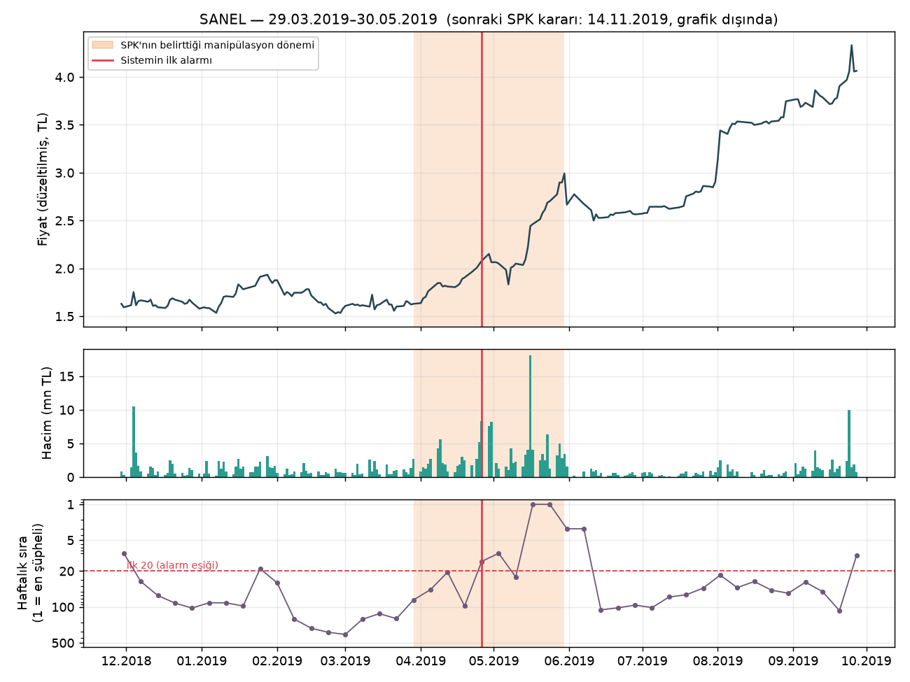
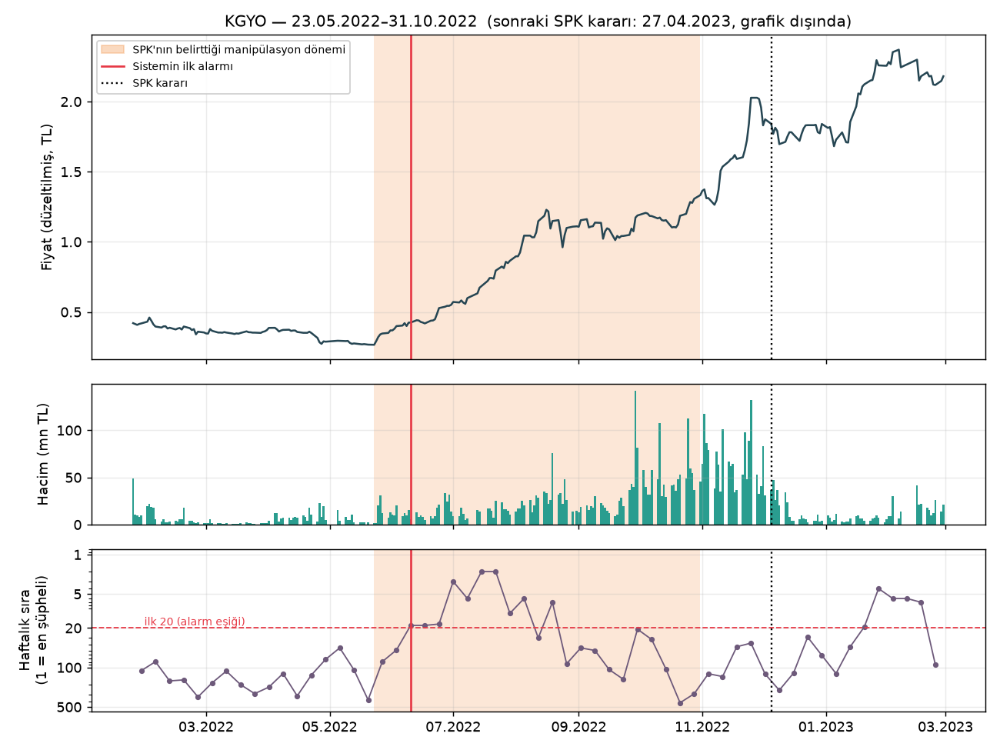
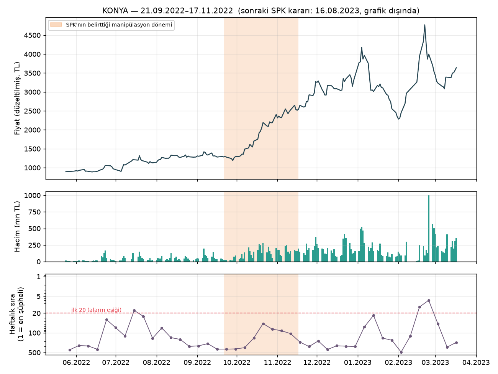
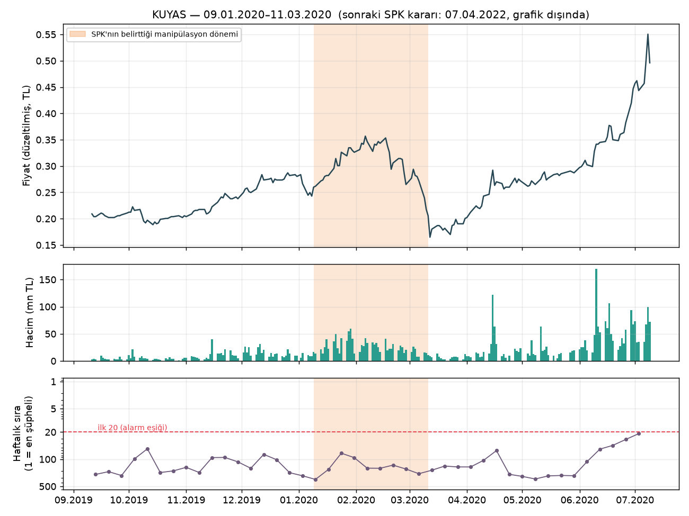

# Vaka çalışmaları

Sistemin gerçek SPK vakalarında nasıl davrandığını gösteren örnekler. Sayılar ve grafikler
`scripts/case_studies.py` ile üretildi (model: kural + PU birleşik skoru, dürüst yıllık eğitim:
her yıl yalnızca o güne kadar bilinen veri ve SPK kararlarıyla eğitilen model).

**Grafiklerin okunuşu.**
- Turuncu alan: SPK kararında yazan manipülasyon dönemi.
- Kırmızı çizgi: sistemin ilk alarmı. Hissenin haftalık listede ilk 20'ye girdiği haftanın cuması.
- Siyah noktalı çizgi: SPK kararı.
- Alt panel: hissenin her hafta ~550 hisse arasındaki sırası (1 = en şüpheli). Kesikli çizginin üstü alarm demektir.

> Not: Vakalar SPK'nın kamuya açık bültenlerindeki kararlara dayanır. Grafikler hisse
> hareketlerini gösterir; kişiler hakkında bir değerlendirme içermez.

## Genel tablo: sistem SPK'dan ne kadar önce uyarıyor?

Değerlendirme dönemi 2017–2026; sistemin yakaladığı 84 vaka:

| | Medyan |
|---|---|
| Manipülasyon başladıktan sonra ilk alarm | 8 gün |
| İlk alarmdan SPK'nın **ilk kararına** (tedbir / işlem yasağı dahil) | 28 gün |
| İlk alarmdan SPK'nın **ilk ceza veya suç duyurusuna** | 404 gün (~13 ay) |

- Vakaların **%94'ünde** alarm, SPK'nın ilk kararından önce geliyor. **%49'unda** en az 30 gün önce.
- Vakaların **%81'inde** alarm, ilk cezadan en az 6 ay önce.
- Dürüst okuma: SPK, pek çok vakada manipülasyon döneminin bitiminden birkaç gün sonra hızlı bir tedbir
  alıyor. Sistemin asıl zaman kazancı ceza/suç duyurusu aşamasına göre; ilk tedbire göre kazanç
  genelde haftalar düzeyinde.

**Seçim kuralı.**
- Aşağıdaki örnekler 2017–2026 vakalarından seçildi.
- **Yakalananlar:** dönemi kısa olan (rastgele seçimle yakalanma olasılığı düşük), sistemin
  haftalık sırada 1–2'ye çıktığı, farklı yıllardan vakalar.
- **Kaçırılanlar:** dönemi birkaç ay süren, buna rağmen hiç alarm almayan vakalar.
- Uzun süren vakalar (ör. 7–8 ay) örnek olarak seçilmedi. Bunları rastgele seçim de büyük olasılıkla
  "yakalar"; bu yüzden gösterici değiller.

---

## Yakalanan vakalar

### 1. IZFAS (İzmir Fırça), Mart–Temmuz 2018: klasik pompala-boşalt

**Fiyat hareketi.**
- SPK'nın belirttiği dönemde (27.03–03.07.2018) fiyat 0,70'ten 1,56'ya çıkıyor (+%123).
- Hacim yükseliyor, fiyat neredeyse her gün artıyor.

**Sistem.**
- İlk alarm 11.05.2018, dönemin 45. günü. Fiyat o sırada 1,06.
- Artışın **%59'u alarmdan sonra** gerçekleşti.
- Hisse Haziran'da haftalık listede **1. sıraya** çıktı.
- Alarm haftasında sağlanan kurallar:
  - 20 günlük piyasa üstü getiri %34.
  - Halka açık kısma göre işlem hacmi normalin 3,3 katı.
  - Son 10 günün 8'i yükseliş.

**SPK.**
- 05.07.2018'de işlem yasağı (alarmdan 55 gün sonra).
- 27.12.2018'de suç duyurusu ve para cezası (230 gün sonra).

**Sonrası.** Yasaktan sonraki haftalarda fiyat **%87 düştü** (1,56 → 0,20). Zirveden alan yatırımcının
zararı, pompala-boşaltın tipik sonucudur.

**Dikkat.** Sistem aynı hisseyi Aralık 2017'de de listeye almıştı. O dönem SPK kararlarında geçmiyor;
ya yanlış alarm ya da SPK'nın incelemediği bir hareket.

### 2. SANEL (SANEL Mühendislik), Mart–Mayıs 2019: kısa, hacim ağırlıklı

**Fiyat hareketi.** Dönemde (29.03–30.05.2019) fiyat 1,63'ten 2,99'a çıkıyor (+%84).

**Sistem.**
- İlk alarm 26.04.2019, dönemin 28. günü. Fiyat o sırada 2,08.
- Artışın **%67'si alarmdan sonra** gerçekleşti.
- Mayıs'ta haftalık listede **1. sıraya** çıktı.
- Alarm haftasında sağlanan kurallar:
  - 5 günlük hacim normalin 4,5 katı.
  - Halka açık kısma göre işlem hacmi normalin 7,4 katı.
  - Son 10 günün 8'i yükseliş.

**SPK.**
- 14.11.2019'da işlem yasağı (alarmdan **202 gün** sonra).
- 28.10.2020'de para cezası (**551 gün** sonra).

**Önemi.** Kısa bir vaka (2 ay). Rastgele seçimle yakalanma olasılığı %41. Sistemin uyarısı, SPK'nın ilk
tedbirinden 6,5 ay önce geliyor.

### 3. KGYO (Koray GYO), Mayıs–Ekim 2022: zor dönemde erken uyarı

**Bağlam.** 2022, Borsa İstanbul'un çok güçlü yükseldiği bir yıldı. Pek çok hisse aynı anda yükseldiği
için sistemin en zorlandığı dönem.

**Fiyat hareketi.** Dönemde (23.05–31.10.2022) fiyat 0,27'den 1,33'e çıkıyor (**+%401, 5 kat**).

**Sistem.**
- İlk alarm 10.06.2022, dönemin 18. günü. Fiyat o sırada 0,42.
- Artışın **%85'i alarmdan sonra** gerçekleşti.
- Temmuz'da haftalık listede 2. sıraya çıktı.
- Alarm haftasında sağlanan kurallar:
  - 20 günlük piyasa üstü getiri %37.
  - 5 günlük hacim normalin 3 katı.
  - Son 10 günün 8'i yükseliş.

**SPK.**
- 05.12.2022'de tedbir (alarmdan 178 gün sonra).
- 27.04.2023'te para cezası (321 gün sonra).

**Dikkat.** Ağustos–Ekim arasında, yükseliş sürerken sistemin sırası 50–400 aralığına düştü. Yükseliş
yavaşlayıp istikrarlı hale gelince "anormal" görünmez oldu. Sistem en çok **başlangıçtaki ani
değişimi** yakalıyor.

---

## Kaçırılan vakalar

### 4. KONYA (Konya Çimento), Eylül–Kasım 2022: piyasayla birlikte yükseliş

**Fiyat hareketi.**
- Dönemde (21.09–17.11.2022) fiyat yaklaşık 1.300'den 2.600'e çıkıyor (2 kat).
- Hacim kademeli artıyor.

**Sistem.** En iyi haftalık sırası 47; hiç alarm yok.

**Neden kaçtı?**
- Aynı dönemde BIST 100 de 20 günde %23'e varan oranda yükseldi. Hissenin endeks üstü getirisi
  ortalama %16'da kaldı; kural eşiği %30.
- Hacim kendi geçmişine göre en fazla 4,6 kat arttı, ortalama 2,3 kat. Bu "ani patlama" değil, kademeli artış.
- Tavan serisi yok, kapanışlar günün tepesinde değil.
- O haftalarda pek çok hisse benzer ya da daha sert yükseldiği için KONYA ilk 20'ye giremedi.

**Ders.** Genel bir yükseliş döneminde, yavaş ve istikrarlı yapılan manipülasyon, günlük fiyat-hacim
verisinde diğer hisselerden ayrışmıyor.

### 5. KUYAS (Kuyaş Yatırım), Ocak–Mart 2020: sessiz manipülasyon

**Fiyat hareketi.**
- Dönemde (09.01–11.03.2020) fiyat 0,25'ten 0,36'ya çıkıyor (+%40).
- Mart 2020'deki COVID çöküşüyle 0,17'ye iniyor.

**Sistem.** En iyi haftalık sırası 70; hiç alarm yok.

**Neden kaçtı?**
- Hareket ölçülü: 20 günlük getiri en fazla %34, hiç tavan yok.
- Hacim normalin en fazla 3,6 katı, ortalama 2 katı.
- Kâğıt üzerinde "biraz hareketli bir hisse" gibi görünüyor.
- SPK'nın manipülasyon tespiti muhtemelen hesap bazlı işlem verisine (kimin kime sattığı) dayanıyor.
  Bu veri günlük fiyat-hacimde görünmez.

**Ders.** Bu tür vakalar için aracı kurum dağılımı (AKD) gibi işlem tarafını gösteren veri gerekir.
Projenin sonraki adımı bu.

---

## Özet

| Vaka | Dönem | Sonuç | İlk alarm | Alarm sonrası artış payı | SPK ilk karar | SPK ceza |
|---|---|---|---|---|---|---|
| IZFAS | Mar–Tem 2018 | Yakalandı | 45. gün | %59 | +55 gün | +230 gün |
| SANEL | Mar–May 2019 | Yakalandı | 28. gün | %67 | +202 gün | +551 gün |
| KGYO | May–Eki 2022 | Yakalandı | 18. gün | %85 | +178 gün | +321 gün |
| KONYA | Eyl–Kas 2022 | Kaçırıldı | — | — | — | — |
| KUYAS | Oca–Mar 2020 | Kaçırıldı | — | — | — | — |

**Sistemin güçlü olduğu yer.** Fiyat ve hacmin hissenin kendi geçmişine ve piyasaya göre **aniden**
ayrıştığı pompala-boşaltlar. Bunları genelde ilk 2–6 haftada, yükselişin büyük kısmından önce yakalıyor.

**Zayıf olduğu yer.** Piyasa geneliyle birlikte yükselen ya da ölçülü hareket eden "sessiz" manipülasyonlar.
Bu vakalarda tespit, günlük veride bulunmayan işlem tarafı bilgisini gerektiriyor.
